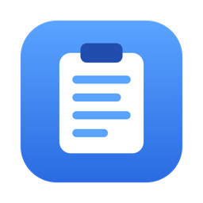
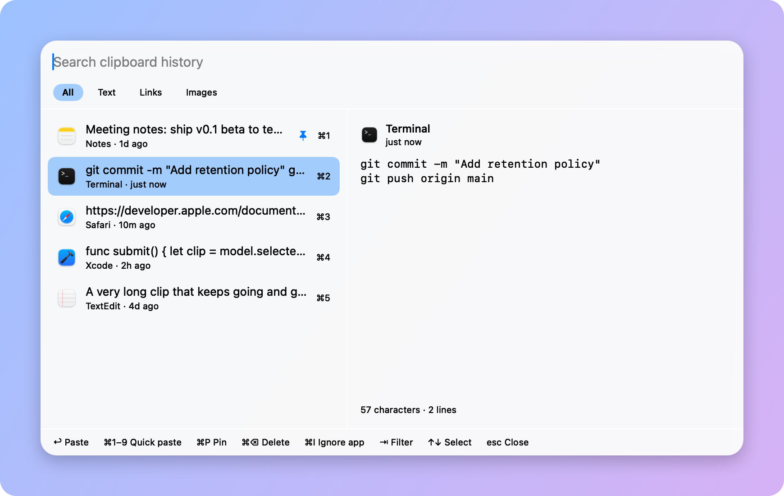
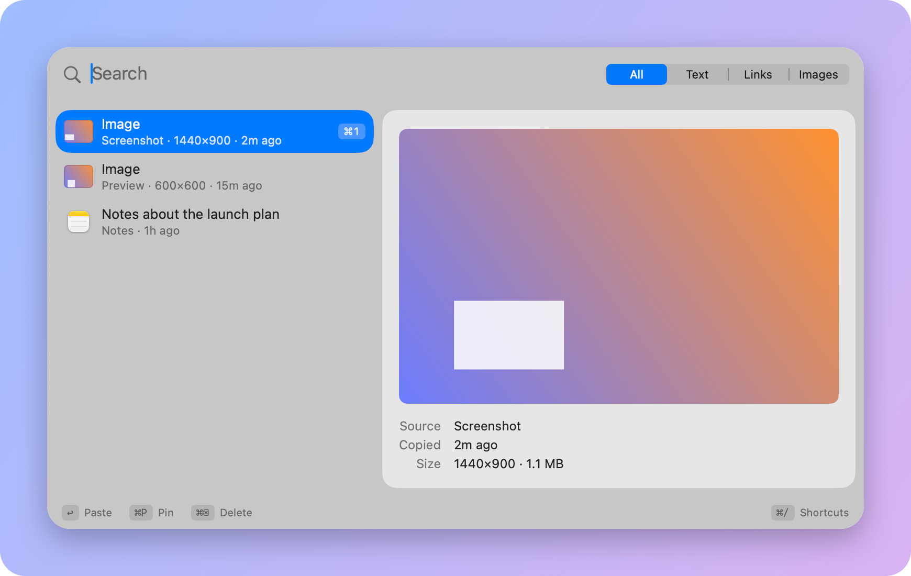

<p align="center">
  
</p>

<h1 align="center">Pastu</h1>

<p align="center">
  A fast, private clipboard manager for macOS.<br>
  Free and open source. Everything stays on your Mac.
</p>

<p align="center">
  
</p>

Press **⌘⇧V**, type a few letters, hit **Return**. Pastu remembers what you copy (text and pictures) and pastes it
back into the app you were using.

> **Early version (0.4).** It works for daily use, but expect rough edges. Builds are not notarized by Apple yet,
> so macOS asks you to confirm the first launch (one extra click, explained below).

## Install

**Homebrew** (one line):

```bash
brew tap keremeersoy/pastu https://github.com/keremeersoy/pastu && brew trust keremeersoy/pastu && brew install --cask pastu
```

Homebrew asks you to trust taps that are not part of Homebrew itself; `brew trust` does that for this one tap.
The cask lives in this repository (`Casks/pastu.rb`) and is updated automatically with every release.

**Or download** [Pastu-0.4.0.zip](https://github.com/keremeersoy/pastu/releases/download/v0.4.0/Pastu-0.4.0.zip),
unzip it and move `Pastu.app` to Applications.

Requires macOS 15 or later on Apple Silicon.

**First launch:** macOS says it cannot verify the developer. Open **System Settings → Privacy & Security**, click
**Open Anyway** next to Pastu, and confirm. You only do this once. (Pastu is not signed with a paid Apple Developer
ID yet. Please don't turn off Gatekeeper for your whole Mac.)

**Allow Accessibility** when asked, so Pastu can paste for you. Without it, Pastu copies the clip and you press ⌘V
yourself.

## Use it

| Key | What it does |
|-----|--------------|
| ⌘⇧V | Open Pastu |
| Type | Search everything you copied |
| ↑ ↓ / Return | Pick a clip and paste it |
| ⌘↑ ⌘↓ / Home End | Jump to the first or last clip |
| Page Up / Page Down | Move a page at a time |
| ⌘1 – ⌘9 | Paste one of the first nine clips |
| ⌥↩ / ⌘↩ | Add the selected clip to the paste queue / paste the whole queue in order |
| ⌘P | Pin a clip (stays on top, never deleted) |
| ⌘⌫ | Delete a clip |
| ⌘Z | Restore the clip you deleted last (until the panel closes) |
| ⌘I | Never record copies from this clip's app |
| Tab / ⇧Tab | Show all, text, links or images (⇧Tab goes backwards) |
| ⌘/ | Show all shortcuts |
| Esc | Clear the search first, then close |

With the mouse: click a clip to select it, double click to paste it, right click for Paste, Copy, Pin, Delete and
Ignore (and Open in Preview for pictures), or drag a clip into another app.

The menu bar icon lets you pause recording, clear the history, manage ignored apps and open Settings.

<p align="center">
  
</p>

## Privacy

- **Nothing leaves your Mac.** No network access, no accounts, no analytics.
- **Passwords are skipped.** Copies that password managers mark as secret are never read or saved.
- **You decide what is recorded.** Ignore any app with ⌘I, or pause recording from the menu bar.
- **Old clips go away.** Pastu keeps up to 5,000 clips for 90 days (pinned clips stay).
- **Good to know:** the history is saved on your disk without encryption. Only your user account can open the file,
  but apps running under your account could read it. Copied screenshots are saved too. Delete anything sensitive
  with ⌘⌫.

## Good to know

- The shortcut is ⇧⌘V by default; change it, or start Pastu at login, under **Settings…** in the menu bar menu.
- Pick the panel's look under Theme in the menu bar menu: System, Light or Dark, and Liquid Glass, Frosted or
  Solid (also under Settings…). Reduce Transparency in System Settings always gives a solid background.
- Search also finds the words inside screenshots and pictures (read on your Mac with Apple's text recognition, switch
  it off in Settings…).
- Text and pictures are supported. Files, colors and rich text are not yet.
- The screenshots above show the panel's layout with sample data. On macOS 26 the real panel has a
  Liquid Glass background.
- Some things have not been tested by hand yet, such as multiple displays and full-screen apps.
  [Tell us](https://github.com/keremeersoy/pastu/issues/new/choose) if something looks off.

## Build from source

You need Xcode 26 or later.

```bash
git clone https://github.com/keremeersoy/pastu.git && cd pastu
swift test
./scripts/build-app.sh && open build/Pastu.app
```

## Contributing

Bug reports, ideas and pull requests are welcome. See [CONTRIBUTING.md](CONTRIBUTING.md) to get started.

## License

[MIT](LICENSE)
